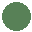

# Ambient Focus & Productivity Desktop Overlay

A tactile, neumorphic Windows desktop companion widget for seamless task management, deep work timer tracking, GitHub-style activity heatmaps, and mindful focus accountability.



## 🌿 Core Features

1. **Tactile Neumorphic Design**:
   - Palette inspired by Forest Sage (`#2D4A3E`, `#588157`, `#A3B18A`) and Cream surfaces (`#DAD7CD`, `#ECE9DF`).
   - Soft extruded shadows, inset active button states, and rounded pill elements.

2. **Always-On-Top vs. Desktop Mode**:
   - **Always-on-Top (📌)**: Floats above all windows for continuous visibility.
   - **Desktop Pin (🖥️)**: Sits calmly at the wallpaper level behind active windows.
   - **Draggable**: Drag anywhere across multiple monitors.

3. **Collapsible Floating Pill**:
   - Minimizes into a sleek floating pill showing active task title, pulsing indicator dot, and live timer.
   - Click or expand button restores the full dashboard.

4. **Task Manager & Per-Task Focus Stopwatch**:
   - Instant task creation and tactile checkmark completion.
   - Stopwatch per task with automatic time logging.
   - Prominent header bar with task title, live elapsed time, and a large **STOP ⏹** button.

5. **GitHub-Style Contribution Heatmap**:
   - 18-week activity matrix representing completed tasks and focus duration.
   - Hover tooltips showing exact date details.
   - Daily streak, completed count, and focus minutes stats.

6. **Accountability Guard ("Are You On Track?")**:
   - Configurable check-in nudges (every 15, 25, 45, or 60 mins).
   - "Still on track?" prompt with motivation quote generator if you drifted.
   - Tracks total distraction count to help build deep work habits.

7. **Quick Notes**:
   - Built-in scratchpad for thoughts, links, and scratch notes with instant auto-save.

8. **Ultra-Lightweight & Windows Auto-Start**:
   - Optimized Electron runtime with zero bloat.
   - Built-in toggle to automatically start with Windows.

---

## 🚀 Quick Start

### Prerequisites
- Node.js (v18+ recommended)

### Installation
```bash
# Clone the repository
git clone https://github.com/abhi478jeetur-rgb/desktop-overlay-component.git
cd desktop-overlay-component

# Install dependencies
npm install

# Start the application
npm start
```

Or simply double-click `Launch-Overlay.bat` on Windows.

---

## 📄 Documentation
- [PRD.md](PRD.md): Product Requirements Document
- [ARCHITECTURE.md](ARCHITECTURE.md): Multi-Agent Architecture Review & Technical Plan

---

## License
MIT
